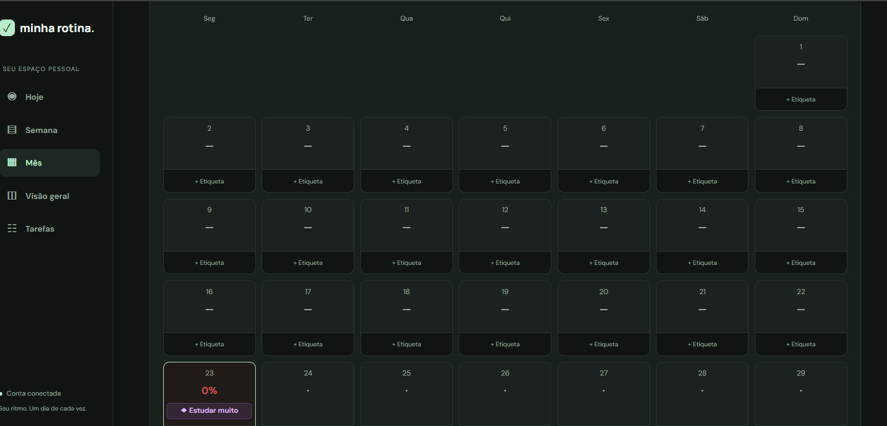
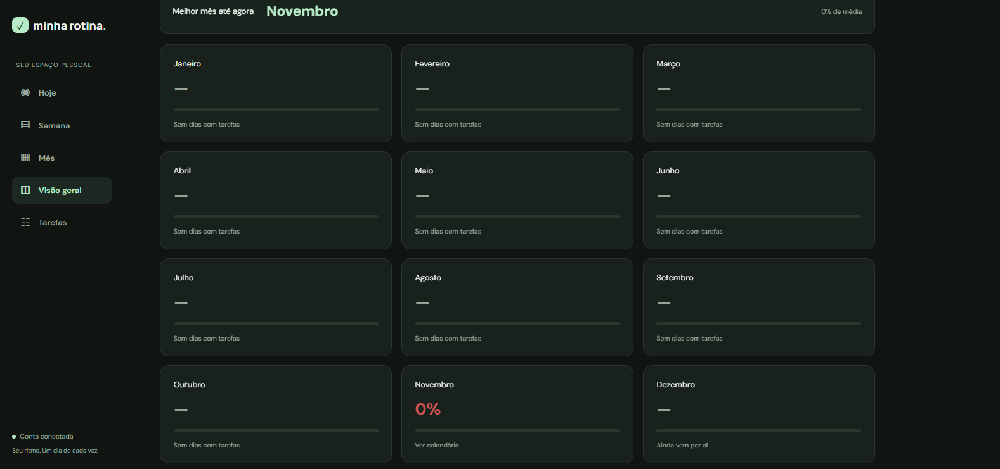

# Minha rotina

Aplicativo web pessoal para acompanhar a rotina do dia a dia: marque as tarefas do dia e veja seu desempenho em porcentagem por dia, semana, mês e ao longo dos meses.

**Online:** https://minha-rotina-publicacao.vercel.app/

## O que ele faz

- **Hoje:** lista das tarefas do dia para marcar como feitas.
- **Semana:** como foi cada dia e o resultado da semana.
- **Mês:** o desempenho do mês, com as semanas e os dias.
- **Visão geral:** todos os meses lado a lado, para ver qual foi melhor e qual foi pior.
- **Tarefas:** criar e gerenciar as tarefas da rotina.
- **Conta própria:** login por e-mail e senha, com os dados na nuvem. O que é marcado no celular aparece no computador.
- **Instalável (PWA):** pode ser adicionado à tela inicial do celular e abre como um aplicativo.
- **Gráfico de contribuições do GitHub (opcional):** mostra o gráfico público de quem informar o nome de usuário.

## Tecnologias

- [React](https://react.dev/) e [Vite](https://vite.dev/) no front-end
- [Supabase](https://supabase.com/) para login e banco de dados
- [Vercel](https://vercel.com/) para a hospedagem
- PWA com service worker

## Como rodar localmente

1. Clone o repositório e instale as dependências:
   ```bash
   npm install
   ```
2. Copie o arquivo `.env.example` para `.env` e preencha com as credenciais públicas do seu projeto Supabase.
3. Inicie o servidor de desenvolvimento:
   ```bash
   npm run dev
   ```

## Capturas de tela

### Hoje

<p align="center">
  
</p>

### Semana

<p align="center">
  
</p>

### Mês

<p align="center">
  
</p>

### Visão geral

<p align="center">
  
</p>

## Próximos passos

- Redesenho completo da interface (front-end), com um visual mais autoral.
- Pequenos ajustes de funcionalidades.

## Autor

Feito por Pedro Gomes, como projeto de estudo e portfólio.
